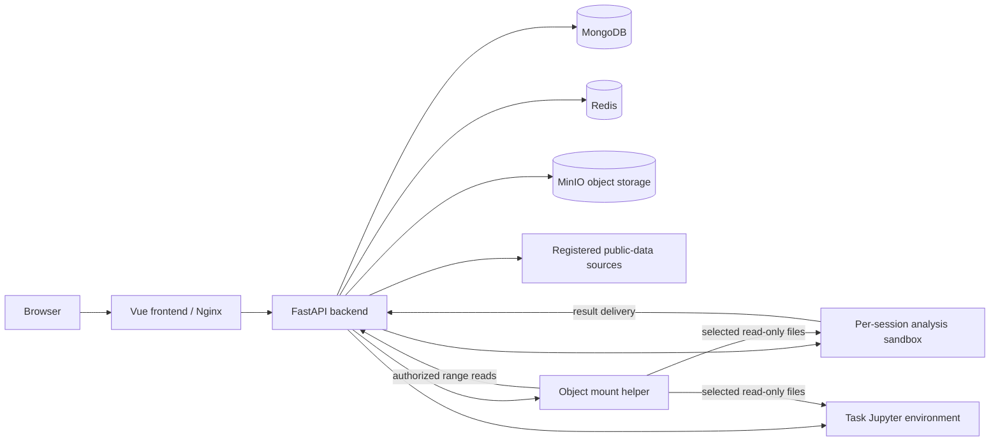

<p align="center">
  
</p>

# DataLab

English | [中文说明](README_zh.md)

DataLab is a conversational workspace for discovering datasets, analyzing selected files, and delivering reusable results. It combines a Vue interface, a FastAPI Agent backend, object storage, and isolated Docker analysis environments.

**Repository:** [km345297256/DataLab](https://github.com/km345297256/DataLab) · **Development branch:** `datalab` · **Default address:** `http://localhost:10030`

## What you can do

| Capability | Workflow |
| --- | --- |
| Discover public data | Describe a research question, choose data sources, inspect candidate records and available files, then acquire selected files. Search and acquisition state persists with the conversation. |
| Upload and organize files | Upload through the multipart flow; preview, search, organize, and reuse files from the personal data library. Saved entries reference existing owned files. |
| Analyze through conversation | Select the inputs for the current request, describe the intended result, and follow analysis steps, clarification requests, execution feedback, and delivered files. |
| Inspect and visualize | Use file previews and format-specific renderers for tables, images, documents, scientific arrays, spatial data, and other supported formats. Large structured inputs use bounded reads where the reader supports them. |
| Reuse analysis methods | Select versioned Data Skills, or use `/skill-creator` after an analysis to prepare a private reusable skill draft. Download the ZIP or explicitly add it to the skill library. |
| Continue work | Inspect session history, execution evidence, and result files; save useful outputs to the data library for a subsequent analysis. |
| Work with notebooks | Use a task-specific Jupyter environment with writable workspaces and the same selected read-only inputs. |
| Collaborate through individual accounts | Register, obtain administrator approval, and use owner-scoped conversations, files, and skills. Sharing requires an explicit action by the owner. |

The public-data catalog includes adapters for sources such as Zenodo, World Bank, NCBI GEO/SRA, OpenML, ScienceDB, and domain repositories. Search availability, file access, query parameters, licensing, and source-side restrictions vary. A search match is not evidence that a file has been downloaded. The current registered catalog lives in [`open_data_registry.py`](backend/app/domain/models/open_data_registry.py); the UI reports acquisition and verification status separately.

The project is focused on dataset exploration and analysis. Claw, A2A networks, scientific-site publishing, knowledge-base indexing, and broad platform administration are outside its scope. See [architecture scope](docs/architecture-scope.md).

## Quick start

### 1. Prepare the host

Use Docker with Docker Compose and enough disk space for the scientific runtime images, build cache, and persistent data. Analysis input mounting requires a Linux Docker host with `/dev/fuse` and shared mount propagation. On macOS or Windows, these capabilities must exist inside the Docker Linux virtual machine; a working Docker CLI alone does not prove mount support.

Git is required to clone the project. For development and local checks, use Node.js 24 (matching the frontend build image), `uv`, Python 3.12+ for the backend, and Python 3.10+ for the sandbox. The full sandbox also depends on Linux system tools, so some local host tests cannot replace container verification.

```bash
git clone --branch datalab https://github.com/km345297256/DataLab.git
cd DataLab
cp .env.example .env
```

### 2. Configure `.env`

Edit the private `.env` file before starting the stack:

| Setting | Purpose |
| --- | --- |
| `API_KEY`, `API_BASE`, `MODEL_PROVIDER`, `MODEL_NAME` | Model access. Use values supported by your provider and chosen model. |
| `JWT_SECRET_KEY` | A persistent random signing secret of at least 32 characters. Keep it stable across restarts. |
| `BOOTSTRAP_ADMIN_EMAIL`, `BOOTSTRAP_ADMIN_PASSWORD` | First administrator; the password must contain at least 12 characters. Bootstrap only creates a missing account. |
| `MINIO_ACCESS_KEY`, `MINIO_SECRET_KEY` | Object-storage credentials. Replace the template secret. |
| `SERVER_HOST` | Browser-facing origin, initially `http://localhost:10030`. Keep it consistent with the address actually used. |
| `FRONTEND_PORT`, `FRONTEND_BIND_HOST` | Default port `10030`; use `127.0.0.1` for local-only access or configure the intended deployment interface. |
| `AUTH_PROVIDER` | Keep `password`; Compose enforces individual account authentication. |

Generate a signing secret locally and place its output in `.env`:

```bash
python3 -c "import secrets; print(secrets.token_urlsafe(48))"
```

Optional SMTP, model context capacity, search, credential-vault, and runtime settings are documented in [`.env.example`](.env.example) and the [deployment guide](docs/deployment.md). Configure context capacity for the actual model; token usage is recorded, while provider rate limits, output limits, and request constraints still apply. Never commit `.env`, private keys, access tokens, or local deployment snapshots.

### 3. Start a new deployment

Check Docker disk usage first, then build and start the stack:

```bash
docker system df
./run.sh config --quiet
./run.sh up -d --build
./run.sh ps
```

Open [`http://localhost:10030`](http://localhost:10030) and sign in with the bootstrap administrator account. After successful initialization, remove the two bootstrap variables from the private configuration and apply that configuration using the deployment procedure. New users register and wait for administrator approval.

These startup commands are for a new, unmanaged installation. If an active production release snapshot already exists, use `./run.sh production` and the [controlled deployment workflow](docs/deployment.md); normal Compose lifecycle changes may be rejected by the release guard. Reuse unchanged sandbox and Jupyter images when updating an existing deployment.

### 4. Run a first analysis

1. Open **New analysis** and upload a small CSV, acquire a public-data file, or choose a file from **My data**.
2. Confirm which files are selected for this request. Selecting an item records a file reference; it does not copy its contents into each conversation.
3. Ask for a concrete output, for example: “Check missing values and duplicate records, summarize numeric columns, and deliver a quality report and cleaned CSV. Explain every cleaning rule.”
4. Answer any unresolved clarification request. Clarification has no default answer and requires an explicit response before execution resumes.
5. Inspect the final explanation and files. Save useful results to **My data** when you want to use them in another analysis.
6. If the method is reusable, invoke `/skill-creator`, review its draft, and choose whether to install it.

Actual results depend on the selected data, model, installed dependencies, and accessible source services. A generated script, a successful command, and a verified delivered result are separate pieces of evidence.

## Navigation

| Route | Purpose |
| --- | --- |
| `/chat` | New analysis; `/` and `/home` are aliases. |
| `/chat/:sessionId` | Analysis conversation, inputs, progress, and results. |
| `/chat/my-data` or `/my-data` | Personal data library. |
| `/skills` | Analysis skill library. |
| `/connectors` | Data connectors. |
| `/visualizations` | Visualization settings. |
| `/account` | Personal center. |
| `/chat/admin` | Account approvals, usage, resource configuration, tasks, MCP, and skills for administrators. |
| `/share/:sessionId` | Owner-created shared conversation view. |

Backend routes use `/api/v1`. FastAPI's generated schema at `/openapi.json` and documentation at `/docs` describe the backend API when accessed through an appropriate backend development endpoint; the frontend proxy should not be assumed to expose those paths.

## Architecture



| Component | Responsibility |
| --- | --- |
| Frontend | Vue 3, TypeScript, and Vite; conversation workspace, data library, previews, visualization adapters, and administration views. |
| Backend | FastAPI, Pydantic, and Beanie; authentication, ownership, Agent execution, events, acquisition, file references, skills, and plugin orchestration. |
| Sandbox | FastAPI, Python scientific packages, shell/file services, Chromium, and VNC. Analysis containers are created dynamically for sessions. |
| Jupyter | Task-specific notebook environment with a separate writable workspace. |
| MongoDB / Redis | Durable application records, events, and coordination/cache functions. |
| MinIO | Canonical storage for uploads, acquired source files, and delivered result objects. |
| Plugin host | Node/TypeScript runtime for registered analysis tools and visualization contracts. |

The Compose project, network/resource prefix, and application image names use `datalab` / `datalab-*`. The `sandbox-image` and `jupyter-image` Compose services are one-shot image preparation services; their successful exit is expected. Actual analysis and notebook containers are managed by the backend. Optional Office preview uses a separate Compose profile; see [Office viewer](docs/onlyoffice-local-viewer.md).

## Data lifecycle and isolation

1. **Acquisition and upload:** selected external files and uploads are persisted to object storage. Resumable transfer staging may exist until object commit; successful staging is reclaimed.
2. **Personal library:** an entry stores an owned reference to a file or file collection. Saving a file again must not duplicate the underlying object. Existing references protect retained files from conversation cleanup.
3. **Input selection:** only explicitly selected, authorized files are exposed to an analysis task. Private bucket keys, credentials, and host mount paths remain in the backend.
4. **Analysis:** a version-pinned rclone helper exposes exact read-only object-backed inputs with disk caching disabled. Short-lived grants scope its access. Computation writes to a separate workspace; it must not create a full-file input cache or silently copy inputs when mounts fail.
5. **Delivery:** readable, stable output files become durable object-storage references after successful upload and byte-identity checks. This mechanical delivery evidence is separate from content or scientific validation. Acquired source files are inputs and must not be republished as newly generated analysis artifacts.

The default `hybrid` provider writes new files to MinIO and retains compatibility reads for older GridFS objects. The legacy `gridfs` configuration value is an alias for this behavior. Compatibility reading does not guarantee that an old object can be used as a mounted analysis input: unsupported legacy sources fail explicitly instead of being copied or migrated automatically.

Historical registered datasets and their ownership remain intact. Legacy host paths must pass `DATASET_HOST_PATH_ALLOWLIST` validation and remain read-only; this does not introduce a new directory-registration API. Real host paths must never be returned to the browser or placed in URLs, `localStorage`, or `sessionStorage`.

## Skills, execution, and result evidence

Data Skills describe reusable methods, inputs, dependencies, output contracts, scripts, and references. The creator prepares a private draft, checks structure and method coverage, and runs supported scripts against small synthetic fixtures. The user explicitly chooses whether to install the package. Older `/skill-create` calls remain compatible.

The current creation pipeline preserves these boundaries:

- **Analysis history:** the latest analysis request must have complete evidence before creation; an incomplete latest request is not silently replaced by an earlier success. Related earlier constraints, decisions, corrections, and verified program versions provide context. Earlier methods must be retained or explicitly justified as superseded or outside the current scope; failed or replaced steps are not automatically accepted as the final method.
- **Declared interfaces:** before writing new scripts, the workflow declares command-line options, input fields and nesting, configuration locations, defaults and missing-value behavior, and output files and structures. The implementation and independent verification share that frozen interface. Previously stored recipes remain readable.
- **Localized revision:** a confirmed defect confined to an existing script permits edits only within the host-authorized script scope. Method, workflow, or interface defects return to workflow revision. A patched implementation still undergoes full checks, independent review, and supported synthetic execution; receiving a review response alone does not mark the method accepted.
- **Privacy:** source projections, generated code, contracts, reviews, and synthetic fixtures pass stage-specific privacy checks. Method references retain source-supported non-private constants while replacing private bindings with unresolved placeholders that must be rebound to current inputs. Only independently reviewed filenames with no analytical meaning may be normalized when initially authoring synthetic file bindings; scientific values, expectations, tolerances, and frozen cases remain unchanged.

A skill is not a guarantee of scientific validity on new data. Check assumptions, parameter choices, input compatibility, and output quality for each use. Skill creation failures preserve delivered analysis files and can be retried separately.

Execution keeps usage accounting, operation identities, progress, and delivery evidence. It has no cumulative task token or wall-clock quota, but individual provider/tool timeouts, context bounds, cancellation, concurrency, and data-access protections remain. Runtime capability catalogs describe observed availability; they do not prohibit other libraries, exports, or APIs. Missing dependencies may be prepared inside the isolated task environment while preserving its input and access boundaries.

Recovery follows recorded execution evidence and checkpoints. It does not mean arbitrary partially executed programs can be replayed safely or every historical task can resume automatically. See [execution recovery](docs/analysis-runtime-recovery.md), [delivery contract](docs/analysis-delivery-contract.md), and [execution reliability](docs/changes-2026-10-25-execution-reliability.md).

## Analysis program and result contracts

Saved Python analysis scripts use `program_run` with an explicit script path, working directory, and literal argument list so the program's own exit status remains observable. When an installed library interface is uncertain, `python_inspect` can inspect a module and up to eight related attributes, returning observed package versions, signatures, and bounded documentation. Imports run in the task sandbox and may have initialization effects; inspection does not call the target function or prove that it fits the selected data. Reuse existing observations rather than adding repeated probes.

The sandbox provides optional helpers for checks that match their documented methods:

| Helper | Checked scope |
| --- | --- |
| `datalab_analysis.RowPartition` / `aligned_groups` | Row conservation and explicit row/group alignment. |
| `datalab_statistics` | Supported nested OLS F comparisons, linear contrasts, and grouped model-residual Levene checks, including required sample identity and method assumptions. |
| `datalab_results.ResultBundle` | A frozen computed-result snapshot shared by JSON, CSV, supported line/scatter plots, and controlled factual report fragments; `verify()` rechecks registered outputs. |

These are optional building blocks. Direct calculations and other libraries remain available; a helper must not change the requested method merely to fit its API. A successful exit, consistent exports, correct numerical checks, and a scientifically suitable interpretation are separate facts. `ResultBundle` neither uploads results nor certifies arbitrary prose, unsupported figures, or the meaning of user-supplied uncertainty bounds.

See [executable result checks](docs/analysis-result-contracts.md) for assumptions and limits, and the [2026-10-26 analysis and skills release notes](docs/releases/2026-10-26-analysis-and-skills.md) for the change scope and verification evidence. Synthetic regressions and any real-model acceptance samples apply only to their documented cases and execution history; they do not establish a general first-attempt success rate or speed improvement.

## Repository layout

```text
DataLab/
├── frontend/          Vue UI, visualization adapters, frontend tests
├── backend/           FastAPI application, repositories, workers, tests
├── sandbox/           Analysis API, scientific helpers, runtime tests
├── jupyter/           Jupyter image definition
├── plugin-host/       TypeScript plugin runtime
├── tools/             Analysis tool manifests and implementations
├── data-skills/       Versioned skill packages and examples
├── data-connectors/   Connector schemas and examples
├── docs/              Architecture, contracts, deployment and change records
├── deploy/            Release tooling and optional service definitions
├── scripts/           Validation and maintenance helpers
├── benchmarks/        Analysis benchmarks and fixtures
├── docker-compose.yml Independent DataLab service stack
├── .env.example       Public configuration template without real credentials
└── run.sh             Compose and controlled-production entry point
```

## Development and validation

Install local dependencies before the first check (`npm ci` in `frontend`, `uv sync` in `backend` and `sandbox`). Then run the required checks from the repository root:

```bash
(cd frontend && npm run type-check && npm run build)
(cd backend && uv run pytest)
(cd sandbox && uv run pytest)
docker compose config --quiet
```

Additional regression checks include `npm test` in `frontend`, `npm run test:browser`, plugin-host tests, and production-tooling tests. [`scripts/check-regressions.sh`](scripts/check-regressions.sh) combines a broader gate, with local and existing-container modes. Browser tests and system-dependent scientific readers have their own prerequisites; see [development guide](docs/development.md).

The commands above describe how to verify a checkout; they are not a claim that every test passes on every operating system. Dated change records describe their own verification environment and must not be treated as results for a different commit.

Preserve the `datalab` branch unless another branch is explicitly selected. Commit only intended project changes, exclude secrets and generated runtime data, and use Chinese commit messages for this repository. See [AGENTS.md](AGENTS.md) for contributor and deployment constraints.

## Documentation map

| Topic | Document |
| --- | --- |
| Full Chinese introduction | [README_zh.md](README_zh.md) |
| Installation, configuration, updates, and operations | [Deployment guide](docs/deployment.md) |
| Local setup, tests, and contribution workflow | [Development guide](docs/development.md) |
| Product and architecture boundary | [Architecture scope](docs/architecture-scope.md) |
| File storage | [MinIO storage](docs/minio-file-storage.md) |
| Data connectors | [Connector contract](docs/data-connector-standard.md) |
| Data Skills | [Package catalog](data-skills/README.md), [package contract](docs/data-skill-package-v1.md), [creation pipeline](docs/skill-creation-pipeline.md) |
| Analysis execution | [Jobs](docs/analysis-jobs.md), [recovery](docs/analysis-runtime-recovery.md), [delivery](docs/analysis-delivery-contract.md), [result checks](docs/analysis-result-contracts.md) |
| Models and context | [Model driver and context budget](docs/model-driver-and-context-budget.md) |
| Plugins and visualization | [Cordis architecture](docs/cordis-plugin-architecture.md), [visualization contract](docs/visualization-plugin-contract.md) |
| Optional Office preview | [Office viewer](docs/onlyoffice-local-viewer.md) |
| Persistent records | [Persistence contracts](docs/persistence/README.md) |
| Current analysis and skills changes | [2026-10-26 release notes](docs/releases/2026-10-26-analysis-and-skills.md) |

Some historical documents retain old DataSeek names, earlier feature boundaries, or dated verification counts. For current behavior, use this introduction together with the active code, configuration, and latest relevant contract.

## Troubleshooting and operational notes

- **The page opens but analysis cannot read inputs:** check Linux FUSE, shared mount propagation, helper startup, and backend reachability. Do not work around mount errors by copying entire input files.
- **Sign-in fails after installation:** verify the persistent JWT secret, bootstrap configuration, and account approval state. Bootstrap does not promote an existing account.
- **A public-data result cannot be downloaded:** inspect its access and verification status. A source may require authorization, reject parameters, rate-limit requests, or provide metadata without directly downloadable files.
- **A build runs out of space:** inspect `docker system df` and reuse unchanged images. Never remove data volumes to make room.
- **A normal update is rejected by the release guard:** follow the controlled production workflow; do not bypass the lock or point a new stack at existing volumes.

The backend controls Docker through its socket; run it on a trusted host. Configure HTTPS and the intended network exposure before public deployment. Back up persistent records and object data together. Keep DataLab networks and volumes separate from any existing DataSeek installation, and preserve the inherited internal database/bucket identifiers unless an explicit migration is planned.

## Origin and license

This independent repository starts from the [`datalab` branch of AI-DATASEEK](https://github.com/km345297256/AI-DATASEEK/tree/datalab) at commit [`5efc7d6`](https://github.com/km345297256/AI-DATASEEK/commit/5efc7d66dcc3b83c40aee47813d422fd3c2701f0), with earlier lineage from AI-MANUS. It was initialized as a clean snapshot without the upstream Git history. Original license and attribution notices are retained.

DataLab is distributed under the [MIT License](LICENSE). Third-party dependencies and downloaded datasets retain their respective licenses and access terms.
