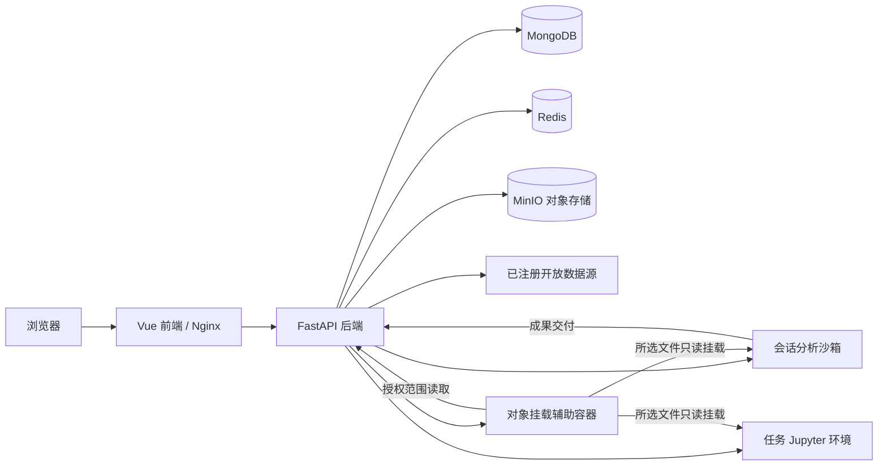

<p align="center">
  
</p>

# DataLab

[English](README.md) | 中文说明

DataLab 是面向数据探索与分析的对话式工作台。用户可以从研究问题出发，检索开放数据、上传和管理自己的文件，在隔离环境中开展分析，最后取得可预览、下载、保存和再次使用的成果。

**GitHub 仓库：** [km345297256/DataLab](https://github.com/km345297256/DataLab) · **开发分支：** `datalab` · **默认访问地址：** `http://localhost:10030`

## 主要能力

| 能力 | 使用方式 |
| --- | --- |
| 开放数据发现与获取 | 描述研究问题、选择数据源、查看候选记录和可获取文件，再获取明确选中的文件。检索与获取状态随会话持久保存。 |
| 文件上传与个人数据空间 | 使用分片上传，预览、搜索、分类和复用文件；保存到“我的数据”时记录已有文件的所有权引用。 |
| 对话式分析 | 选择本轮输入，说明分析目标，查看计划、澄清问题、执行反馈与交付文件。 |
| 文件预览与科学可视化 | 支持表格、图像、文档、科学数组、空间数据等格式的专用预览；支持窗口读取的解析器按需读取大型结构化输入。 |
| 可复用分析技能 | 选择版本化 Data Skill，或在分析后使用 `/skill-creator` 创建私有技能草稿，下载 ZIP 或明确添加到个人技能库。 |
| 历史与成果复用 | 查看会话、执行证据与结果文件，将有价值的成果保存后用于后续分析。 |
| Jupyter 工作环境 | 为任务提供独立 Notebook 环境，写入工作空间与选中输入的只读挂载分离。 |
| 多用户访问 | 密码账号、管理员审批、按所有者隔离的会话/文件/技能；分享由所有者主动发起。 |

开放数据目录包含 Zenodo、World Bank、NCBI GEO/SRA、OpenML、ScienceDB 及领域数据仓储等适配器。不同来源的检索方式、查询参数、文件权限、许可证与可用性并不相同；“检索到记录”不等于“已取得完整文件”。当前目录以 [`open_data_registry.py`](backend/app/domain/models/open_data_registry.py) 为准，界面分别显示可获取核验、下载与保存状态。

项目专注于数据探索与分析，不包含 Claw、A2A Agent 网络、科学站点发布、知识库索引或泛平台管理。详细边界见[架构范围说明](docs/architecture-scope.md)。

## 快速开始

### 1. 准备环境并取得代码

运行完整服务需要 Docker、Docker Compose，以及可容纳科学计算镜像、构建缓存和持久数据的磁盘空间。分析输入挂载要求 Linux Docker 主机具备 `/dev/fuse` 与共享挂载传播能力；在 macOS 或 Windows 上，这些能力需要在 Docker 的 Linux 虚拟机内成立，不能只凭 Docker 命令可用就认为挂载已就绪。

本地开发建议使用与前端镜像一致的 Node.js 24；后端需要 Python 3.12+，沙箱 Python 项目要求 3.10+，并通过 `uv` 管理依赖。完整科学运行时还需要 Linux 系统工具，本机 Python 测试不能替代相应容器验证。

```bash
git clone --branch datalab https://github.com/km345297256/DataLab.git
cd DataLab
cp .env.example .env
```

### 2. 填写私有配置

启动前编辑 `.env`：

| 变量 | 说明 |
| --- | --- |
| `API_KEY`、`API_BASE`、`MODEL_PROVIDER`、`MODEL_NAME` | 模型调用配置；填写所用服务与模型实际支持的值。 |
| `JWT_SECRET_KEY` | 至少 32 字符的持久随机签名密钥；重启和更新时保持不变。 |
| `BOOTSTRAP_ADMIN_EMAIL`、`BOOTSTRAP_ADMIN_PASSWORD` | 首位管理员的邮箱与密码；密码至少 12 字符，仅在账号不存在时创建。 |
| `MINIO_ACCESS_KEY`、`MINIO_SECRET_KEY` | 对象存储凭据，必须替换模板密码。 |
| `SERVER_HOST` | 浏览器实际使用的访问源，默认 `http://localhost:10030`。 |
| `FRONTEND_PORT`、`FRONTEND_BIND_HOST` | 默认端口 `10030`；仅本机访问时使用 `127.0.0.1`，其他部署按实际网络入口设置。 |
| `AUTH_PROVIDER` | 保持 `password`，Compose 强制使用个人账号认证。 |

可以在本地生成签名密钥，再将结果填入 `.env`：

```bash
python3 -c "import secrets; print(secrets.token_urlsafe(48))"
```

SMTP、模型上下文容量、搜索、凭据保管与运行时的更多设置见 [`.env.example`](.env.example) 和[部署运维说明](docs/deployment.md)。上下文容量应匹配实际模型；系统记录 token 用量，模型服务本身的速率、输出上限与请求约束仍然生效。`.env`、真实密钥、访问令牌和本地发布快照不能进入 Git 仓库。

### 3. 启动全新部署

先查看 Docker 磁盘占用，再构建与启动：

```bash
docker system df
./run.sh config --quiet
./run.sh up -d --build
./run.sh ps
```

打开 [`http://localhost:10030`](http://localhost:10030)，使用初始化的管理员账号登录。确认初始化成功后，从私有配置中移除两个 `BOOTSTRAP_ADMIN_*` 变量，并按部署流程应用配置。普通用户注册后需要管理员批准。

以上启动命令适用于尚未启用活动发布快照的新安装。已有受控生产版本时，应先运行 `./run.sh production` 并遵循[受控部署流程](docs/deployment.md)；发布保护可能拒绝直接执行普通 Compose 启停命令。更新既有部署时，复用未改动的 Sandbox 与 Jupyter 镜像。

### 4. 完成一次分析

1. 在“新建分析”上传一个小型 CSV，或从开放数据中获取文件，也可以从“我的数据”选择已有文件。
2. 检查本轮已选输入。选择只记录文件引用，不会为每个会话复制文件内容。
3. 提出具体任务，例如：“检查缺失值和重复记录，汇总数值列，输出质量报告和清洗后的 CSV，并说明每一条清洗规则。”
4. 如果出现待澄清问题，明确回复后继续。确认卡没有默认答案，取消后不会继续旧请求。
5. 查看结果说明和交付文件；需要跨会话复用时，将成果保存到“我的数据”。
6. 如果分析方法可复用，使用 `/skill-creator` 创建草稿，检查内容后决定是否添加到技能库。

结果取决于输入数据、所选模型、依赖环境和数据源可用性。保存了脚本、命令执行成功、实际成果验证通过是不同证据，不能相互替代。

## 页面入口

| 路径 | 用途 |
| --- | --- |
| `/chat` | 新建分析，`/` 与 `/home` 为别名。 |
| `/chat/:sessionId` | 分析对话、输入、进度与结果。 |
| `/chat/my-data` 或 `/my-data` | 个人数据空间。 |
| `/skills` | 分析技能库。 |
| `/connectors` | 数据连接器。 |
| `/visualizations` | 可视化设置。 |
| `/account` | 个人中心。 |
| `/chat/admin` | 管理员的用户审批、资源用量、资源配置、任务、MCP 与技能管理。 |
| `/share/:sessionId` | 由所有者主动创建的会话分享页。 |

后端 API 统一使用 `/api/v1` 前缀。在适当的后端开发访问入口，可查看 FastAPI 的 `/openapi.json` 和 `/docs`；前端代理并不一定对外暴露这两个路径。

## 技术架构



| 组件 | 技术与职责 |
| --- | --- |
| Frontend | Vue 3、TypeScript、Vite；对话工作台、个人数据、文件预览、可视化适配器和管理界面。 |
| Backend | FastAPI、Pydantic、Beanie；认证、归属检查、Agent 执行、事件、数据获取、文件引用、技能与插件调度。 |
| Sandbox | FastAPI、Python 科学计算依赖、Shell/文件服务、Chromium 和 VNC；按会话动态创建分析环境。 |
| Jupyter | 每任务独立的 Notebook 环境与可写工作空间。 |
| MongoDB / Redis | 应用持久记录、事件以及协调和缓存能力。 |
| MinIO | 上传文件、获取的源数据和交付成果的规范持久存储。 |
| Plugin host | Node/TypeScript 插件运行时，承载注册的分析工具与可视化契约。 |

Compose 项目名与资源前缀默认为 `datalab`，应用镜像使用 `datalab-*`。`sandbox-image` 和 `jupyter-image` 是一次性镜像准备服务，正常退出是预期行为；真正的分析和 Notebook 容器由后端管理。Office 高保真预览使用独立的可选 Compose profile，见 [Office 预览说明](docs/onlyoffice-local-viewer.md)。

## 数据生命周期与隔离边界

1. **获取和上传：** 文件先持久保存至对象存储；可恢复下载允许在对象提交前保留临时传输片段，成功后清理暂存。
2. **个人数据空间：** 条目记录有归属的文件或文件集合引用；再次保存不复制底层对象。仍被引用的文件不会因原会话清理而丢失。
3. **输入选择：** 任务只能访问明确选中、已经授权的文件；桶对象键、存储凭据和宿主挂载路径保留在后端。
4. **分析执行：** 固定版本的 rclone 辅助容器以关闭磁盘缓存的方式提供精确的对象只读挂载，使用限定范围的短期授权。可写计算空间与输入分离；不能创建整文件输入缓存，也不能在挂载失败后静默复制输入。
5. **成果交付：** 可读取、稳定的生成文件在成功上传并核对字节身份后，保存为持久对象引用。这类交付证据与内容、科学结论检查分别记录。获取的源文件属于分析输入，不能冒充新生成的分析成果再次交付。

默认 `hybrid` 文件提供者将新文件写入 MinIO，同时兼容读取旧 GridFS 对象；历史 `gridfs` 配置值是这一行为的别名。兼容读取不等于所有旧对象都支持分析挂载：无法满足只读对象挂载的旧来源会明确失败，不自动复制或迁移。

已有注册数据集及其所有权继续保留。历史宿主路径仍须通过 `DATASET_HOST_PATH_ALLOWLIST` 验证并保持只读，这不意味着重新开放目录注册入口。真实宿主路径不得进入浏览器响应、URL、`localStorage` 或 `sessionStorage`。

## 技能、执行与结果证据

Data Skill 描述可复用的方法、输入、依赖、输出契约、脚本和参考资料。技能创建器先产生私有草稿，进行结构与方法覆盖检查，并对支持的脚本使用小型合成数据验证；用户明确选择后才安装。旧 `/skill-create` 命令保持兼容。

当前创建流程保留以下边界：

- **分析历史：** 最近一次分析须具备完整证据后才创建，不能在最新请求尚未完成时静默选用更早的成功记录；同时结合相关历史中的约束、决策、修正和已核验程序版本。历史方法须明确保留，或说明被后续取代、与当前任务无关；失败或被替换的步骤不会自动成为最终方法。
- **显式接口：** 新脚本生成前先声明命令行选项、输入字段与层级、配置位置、默认值和缺失值行为，以及输出文件与结构。实现和独立验证共用已冻结的接口，既有保存配方仍可读取。
- **局部修订：** 确认仅属于已有脚本的实现缺陷时，只允许修改宿主授权的脚本范围。方法、工作流或接口有误时，回到工作流修订；代码修改后仍需完整检查、独立复审和支持范围内的合成执行。收到审查响应不等于方法已经通过。
- **隐私检查：** 方法参考、生成源码、契约、审查和合成资料经过分阶段隐私检查。参考保留有来源支持的非私有方法常量，私有绑定改为待解析占位，必须重新绑定当前输入。只有经独立审查确认文件名不承载分析含义时，才允许在初始合成用例编写阶段规范化文件绑定；科学数值、期望、容差与已冻结用例保持不变。

技能验证不代表新数据上的科研结论已经得到认证。每次使用仍需检查方法假设、参数、输入兼容性与结果质量。技能创建失败时保留已交付分析，并支持单独重试创建。

执行过程保留用量统计、操作身份、进度与交付证据，不设置累积任务 token 或总运行时长额度；单次模型/工具超时、上下文容量、取消、并发与数据访问边界仍然有效。运行时能力目录描述观察到的环境，不是允许使用的依赖、导出项或 API 清单。缺失依赖可在任务隔离环境内准备，但必须维持输入只读、授权访问与执行隔离。

恢复依据已记录的执行证据和检查点进行，不承诺任意部分执行的程序可以安全重放，也不表示所有历史任务都能自动续跑。详见[执行恢复](docs/analysis-runtime-recovery.md)、[成果交付契约](docs/analysis-delivery-contract.md)及[通用执行可靠性](docs/changes-2026-10-25-execution-reliability.md)。

## 分析程序与结果契约

已保存的 Python 分析脚本通过 `program_run` 显式传入脚本路径、工作目录和参数数组，以保留程序本身的退出状态。对已安装库的接口不确定时，可用 `python_inspect` 一次查看一个模块及最多 8 个相关属性，取得实际包版本、签名和有限文档。导入发生在任务沙箱中，可能触发初始化行为；该工具不调用目标函数，也不证明接口适合所选数据。已经取得的观察应继续复用，避免重复探测。

沙箱提供以下可选辅助组件，按其公开方法与适用条件选择：

| 组件 | 检查范围 |
| --- | --- |
| `datalab_analysis.RowPartition` / `aligned_groups` | 行守恒与明确的行、分组对齐。 |
| `datalab_statistics` | 支持范围内的嵌套 OLS F 比较、线性对比和分组模型残差 Levene 检查，包括必要的样本身份与方法假设。 |
| `datalab_results.ResultBundle` | 冻结同一份计算结果，生成 JSON、CSV、支持的折线/散点图及受控报告事实片段，并通过 `verify()` 重新检查已登记产物。 |

这些组件按需使用；直接计算与其他库仍然可用，不能为了适配辅助函数改变用户要求的方法。程序退出成功、导出一致、数值检查通过和科学解释适当是不同事实。`ResultBundle` 不负责上传，也不核验任意报告正文、未支持的图形或调用者提供的误差上下界的统计含义。

适用条件与限制详见[可执行的分析结果检查](docs/analysis-result-contracts.md)，变更范围与验证证据见 [2026-10-26 分析与技能更新说明](docs/releases/2026-10-26-analysis-and-skills.md)。合成回归与真实模型验收样本仅描述对应案例和执行历程，不能推断普遍的首次成功率或耗时改善。

## 目录结构

```text
DataLab/
├── frontend/          Vue 界面、可视化适配器与前端测试
├── backend/           FastAPI 应用、存储接口、后台任务与测试
├── sandbox/           分析 API、科学计算辅助模块与运行时测试
├── jupyter/           Jupyter 镜像定义
├── plugin-host/       TypeScript 插件运行时
├── tools/             分析工具声明与实现
├── data-skills/       版本化技能包与样例
├── data-connectors/   数据连接器 schema 与样例
├── docs/              架构、契约、部署和变更记录
├── deploy/            发布工具及可选服务定义
├── scripts/           验证与维护辅助脚本
├── benchmarks/        分析基准及测试资料
├── docker-compose.yml DataLab 独立服务栈
├── .env.example       不含真实凭据的公共配置模板
└── run.sh             Compose 与受控生产部署入口
```

## 开发与验证

首次检查前安装本地依赖：在 `frontend` 执行 `npm ci`，在 `backend` 和 `sandbox` 分别执行 `uv sync`。随后在仓库根目录运行必要检查：

```bash
(cd frontend && npm run type-check && npm run build)
(cd backend && uv run pytest)
(cd sandbox && uv run pytest)
docker compose config --quiet
```

其他回归包括前端 `npm test`、`npm run test:browser`、plugin-host 测试与生产发布工具测试。[`scripts/check-regressions.sh`](scripts/check-regressions.sh) 整合了更完整的检查，并提供本机与复用现有容器镜像两种模式。浏览器测试和科学解析器有各自环境要求，详见[开发说明](docs/development.md)。

这些命令说明如何验证当前检出，不代表每项测试在所有操作系统都已通过。带日期的变更报告只记录对应代码与环境的结果，不能作为另一提交的测试结论。

默认保留 `datalab` 分支，只提交本次需要的项目文件，排除密钥、运行时数据及无关改动，提交信息使用中文。仓库协作与部署规则见 [AGENTS.md](AGENTS.md)。

## 文档索引

| 主题 | 文档 |
| --- | --- |
| 安装、配置、更新与运维 | [部署运维说明](docs/deployment.md) |
| 本地开发、测试与贡献流程 | [开发说明](docs/development.md) |
| 产品与架构范围 | [架构范围](docs/architecture-scope.md) |
| 对象与文件存储 | [MinIO 文件存储](docs/minio-file-storage.md) |
| 数据连接器 | [连接器标准](docs/data-connector-standard.md) |
| Data Skills | [技能目录](data-skills/README.md)、[包契约](docs/data-skill-package-v1.md)、[创建流程](docs/skill-creation-pipeline.md) |
| 分析执行 | [分析作业](docs/analysis-jobs.md)、[恢复](docs/analysis-runtime-recovery.md)、[交付](docs/analysis-delivery-contract.md)、[结果检查](docs/analysis-result-contracts.md) |
| 模型与上下文 | [模型驱动与上下文预算](docs/model-driver-and-context-budget.md) |
| 插件与可视化 | [Cordis 架构](docs/cordis-plugin-architecture.md)、[可视化插件契约](docs/visualization-plugin-contract.md) |
| Office 可选预览 | [Office 预览说明](docs/onlyoffice-local-viewer.md) |
| 持久记录 | [持久化契约](docs/persistence/README.md) |
| 本轮分析与技能更新 | [2026-10-26 更新说明](docs/releases/2026-10-26-analysis-and-skills.md) |

历史文档可能保留 DataSeek 名称、早期功能边界或当时的验证数量。理解当前行为时，应结合本说明、现行代码与配置以及相关契约的最新修改。

## 常见问题与运维提示

- **页面能打开，但分析无法读取输入：** 检查 Linux FUSE、共享挂载传播、挂载辅助容器启动与后端可达性，不以整文件复制绕过挂载错误。
- **初始化后无法登录：** 检查 JWT 密钥、管理员初始化配置与账号审批状态；初始化逻辑不会把已有普通账号提升为管理员。
- **开放数据记录无法下载：** 查看访问与核验状态。来源可能需要授权、拒绝查询参数、暂时限流，或者只提供元数据线索。
- **构建磁盘不足：** 先查看 `docker system df`，复用未变化的镜像；不能通过删除数据卷腾出空间。
- **直接更新被发布保护拒绝：** 使用受控生产发布流程，不绕过锁或让新服务栈误用既有数据卷。

后端通过 Docker socket 管理容器，应运行在可信主机。对公网开放前配置 HTTPS 和实际需要的网络入口；备份时同时保留数据库记录与对象数据。DataLab 网络、卷与已有 DataSeek 部署保持分离；内部数据库和 bucket 兼容标识只在明确的数据迁移计划下修改。

## 来源与许可证

本独立项目以 [AI-DATASEEK 的 `datalab` 分支](https://github.com/km345297256/AI-DATASEEK/tree/datalab)提交 [`5efc7d6`](https://github.com/km345297256/AI-DATASEEK/commit/5efc7d66dcc3b83c40aee47813d422fd3c2701f0) 为初始基线，原项目更早源自 AI-MANUS。DataLab 以清理后的初始快照建立，不包含上游 Git 历史，保留原许可证与归属声明。

项目采用 [MIT License](LICENSE)。第三方依赖和下载的数据集仍适用各自的许可证及访问条件。
